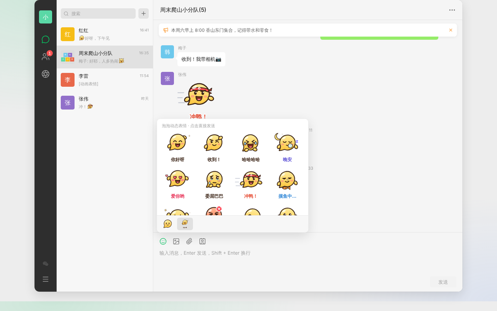
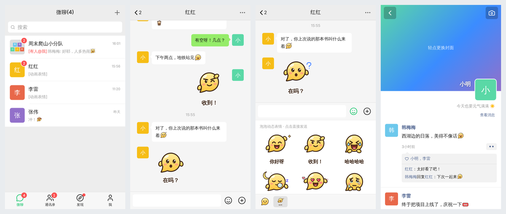

# 微聊

一款类微信的即时通讯 Web 应用：好友、私聊、群聊、朋友圈、实时消息，**桌面端和手机端都能用**，还有一套原创的「泡泡」表情。





## 功能

| 模块 | 功能 |
| --- | --- |
| 账号 | 注册 / 登录、修改个人资料（头像、昵称、性别、地区、签名）、修改密码（旧登录会失效） |
| 好友 | 按微聊号/昵称搜索、发送验证消息并设置备注、接受 / 拒绝申请、互相申请时自动通过、备注、星标朋友、推荐名片、删除好友、在线状态 |
| 通讯录 | 拼音 A–Z 分组与右侧索引、星标朋友、新的朋友（未处理数角标）、我的群聊 |
| 聊天 | 文字、「泡泡」表情、动态大表情、图片（粘贴/拖拽/选择）、文件、个人名片；引用回复、2 分钟内撤回（可重新编辑）、转发（最多 9 个会话）、复制；“对方正在输入…”；发送失败重发；草稿；查找聊天记录；未读数、`[有人@我]`、`[草稿]` 提示；置顶、免打扰、标为未读、清空记录、删除聊天 |
| 群聊 | 选好友发起群聊、九宫格群头像、邀请 / 移出成员、修改群名、群公告（@所有人通知）、我在本群的昵称、@成员 / @所有人、转让群主、群主退群自动移交、解散群聊、按群号搜索加入（可关闭）、新成员看不到入群前的记录 |
| 朋友圈 | 发文字 + 最多 9 张图、点赞、评论 / 回复、删除；只能看到共同好友的赞和评论（同微信规则）；新消息通知、好友新动态红点、个人相册页、自定义封面 |
| 体验 | 深色模式（跟随系统 / 浅色 / 深色）、提示音、后台桌面通知、标题栏未读数、断线自动重连并补齐消息 |

## 「泡泡」表情

表情全部是自己设计的：以微聊的气泡 Logo 为原型，每个表情都是一个**带聊天气泡小尾巴的圆脸团子**，暖黄配色、玻璃高光、粉色腮红、棕色描边。

- **54 个小表情**：在文字里以 `[微笑]` 这样的代码存储，显示为图片；除了常规表情，还有「吃瓜」「奋斗」「口罩」「呆」这类本土特色表情，以及奶茶、红包、福、666 等图标
- **14 个动态大表情**：「你好呀」「收到！」「冲鸭！」「摸鱼中…」「谢谢老板」「吃瓜群众」等，带配字和循环动画，点击直接发送
- 全部是纯 SVG，由部件（眼睛 / 嘴巴 / 眉毛 / 装饰）组合生成，体积小、任意缩放都清晰，深色模式下也看得清


源码在 `client/src/emoji/`：`art.js` 是小表情，`stickers.js` 是动态大表情。

## 手机端

- 自适应布局：手机上是底部「微聊 / 通讯录 / 发现 / 我」标签栏 + 全屏页面，电脑上是三栏桌面客户端布局
- 长按消息 / 会话弹出底部操作面板；图片查看器支持左右滑动
- 键盘弹出时输入框始终可见（iOS 和安卓都做了适配），输入时页面不会被放大
- 适配刘海屏安全区；返回按钮与手机的返回手势一致
- 支持**添加到主屏幕**（PWA），像原生 App 一样全屏打开

## 快速开始

需要 Node.js 20.19+（推荐 22）。

```bash
npm install
npm run seed   # 可选：创建演示账号和聊天数据
npm run dev    # 开发模式：前端 http://localhost:5173（接口自动代理到 3000 端口）
```

演示账号：`xiaoming`、`xiaohong`、`lilei`、`hanmeimei`、`zhangwei`、`wangfang`，密码都是 `123456`。
建议用两个浏览器（或一个普通窗口 + 一个无痕窗口）分别登录，体验实时聊天。

生产运行：

```bash
npm run build  # 构建前端到 client/dist
npm start      # http://localhost:3000，同时提供接口和前端页面
```

### 在手机上打开

手机和电脑连同一个 Wi-Fi，用手机浏览器访问 `http://电脑的局域网IP:3000`（开发模式用 `5173` 端口）。
「添加到主屏幕」在 iOS Safari 里可直接使用；安卓 Chrome 的安装提示需要 HTTPS（或 localhost），部署到服务器时请配上证书。

## 部署到云平台（获得公网链接）

仓库里已经带了 `Dockerfile` 和 Render 用的 `render.yaml`。部署要点只有两个：

- 在 **`/data`** 挂一块持久化磁盘（Volume）。数据库、上传的图片和登录密钥都存在这里，不挂的话每次重新部署数据都会清空。
- 可选：设置环境变量 `SEED_DEMO=1`。第一次启动时会创建演示账号（密码 `123456`），之后重启不会重复创建。

### 方案 A：Railway

1. 用 GitHub 登录 [railway.com](https://railway.com)，New Project → Deploy from GitHub repo → 选这个仓库和分支。它会自动识别 `Dockerfile`。
2. 在服务上 **Add Volume**，挂载路径填 `/data`。
3. Variables 里按需添加 `SEED_DEMO=1`。
4. Settings → Networking → **Generate Domain**，得到 `https://xxx.up.railway.app`，这就是体验链接。

### 方案 B：Render

1. 用 GitHub 登录 [render.com](https://render.com)，New → **Blueprint** → 选这个仓库，会按 `render.yaml` 自动创建服务（含 `/data` 磁盘和健康检查）。
2. 部署完成后会得到 `https://weiliao-xxxx.onrender.com`。

> 平台的价格和免费额度经常调整，请以官网为准。Render 的持久化磁盘需要付费实例；免费实例没有磁盘，重新部署后数据会丢失。

### 自己的服务器

```bash
docker build -t weiliao .
docker run -d -p 3000:3000 -v weiliao-data:/data -e SEED_DEMO=1 --restart unless-stopped weiliao
```

前面用 Nginx 或 Caddy 配上 HTTPS，并转发 WebSocket（`/socket.io/`）。

## 配置

| 环境变量 | 默认值 | 说明 |
| --- | --- | --- |
| `PORT` | `3000` | 服务端口 |
| `DATA_DIR` | `server/data` | SQLite 数据库所在目录 |
| `UPLOAD_DIR` | `server/uploads` | 上传文件目录 |
| `JWT_SECRET` | 自动生成并保存在 `DATA_DIR/.jwt-secret` | 登录令牌签名密钥 |
| `SEED_DEMO` | 未设置 | 设为 `1` 时，空数据库启动会自动创建演示账号 |

## 技术栈与目录

- 前端：React 19 + React Router + Zustand + Vite，原生 CSS（`light-dark()` 主题变量）
- 后端：Node.js + Express 5 + Socket.IO + SQLite（better-sqlite3）
- 认证：bcrypt 密码哈希 + JWT；上传文件以随机文件名保存，并以 `nosniff` + CSP `sandbox` 方式提供，非图片强制下载

```
server/
  src/index.js        入口：HTTP + Socket.IO + 静态资源
  src/routes/         auth / users / friends / conversations / messages / groups / moments / upload
  src/views.js        数据视图（会话摘要、未读数、@我 等）
  src/realtime.js     实时推送、在线状态、正在输入
  src/seed.js         演示数据
  test/api.test.js    接口测试
client/
  src/pages/          聊天、通讯录、朋友圈、我
  src/components/     头像、弹窗、菜单、选择器等通用组件
  src/emoji/          「泡泡」表情与动态表情
  src/lib/            接口、状态、实时连接、偏好设置
```

## 测试

```bash
npm test       # 服务端接口测试（注册登录、好友、私聊、群聊全流程、朋友圈、上传安全、表情消息）
npm run lint   # 前端 ESLint
```

## 上线前建议

- 用 HTTPS 部署（反向代理到 3000 端口，并转发 WebSocket）
- 设置固定的 `JWT_SECRET`，定期备份 `DATA_DIR` 和 `UPLOAD_DIR`
- 目前没有登录频率限制、消息端到端加密和音视频通话，如需对公网开放建议先补上频率限制
